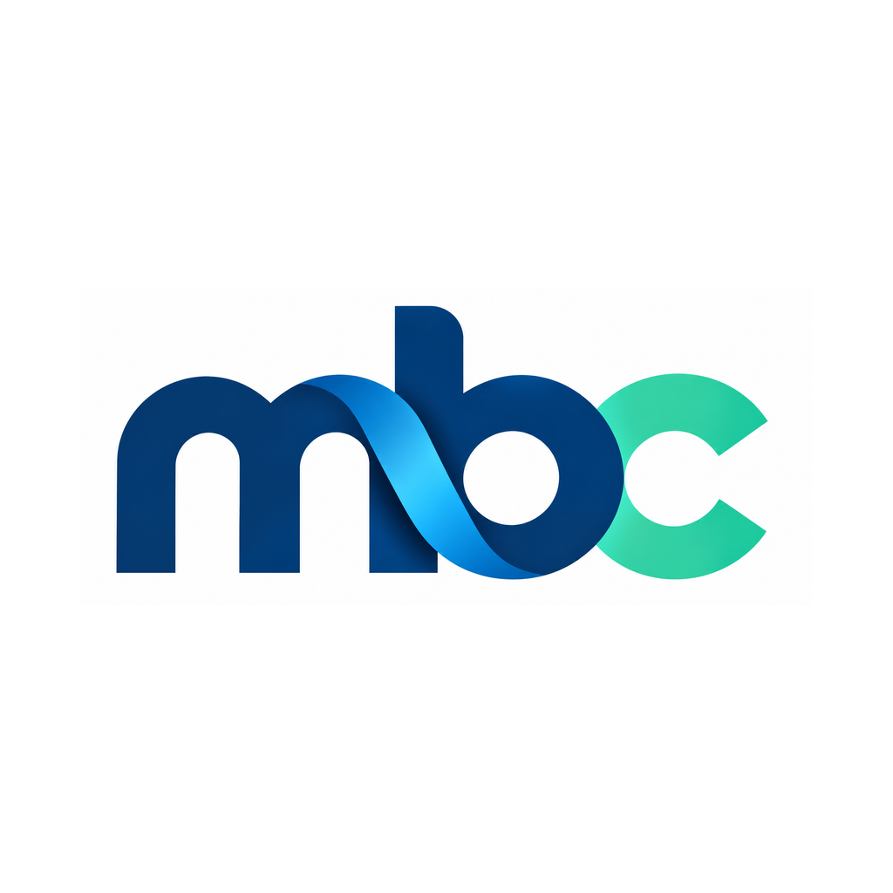

# My Budget Control for AI assistants

Official Cenulinq connector configuration for the existing My Budget Control MCP service: **https://cenulinq.com/mcp**.

View monthly totals from your own entered budget records, prepare one expense proposal for separate human confirmation on MBC, and check its approval status. These are budget records, not a verified bank balance. No bank payments, banking access, subscription changes, deletion or bulk editing.

## Account and privacy

Use your own confirmed MBC account, age 18+, with the existing applicable trial/subscription access. Sign in and approve OAuth on cenulinq.com. Grants last 15 minutes without background refresh; reconnect after expiry. Each proposed expense requires a separate confirmation in MBC. Keep your AI platform’s tool approvals enabled. Never paste a password or token into an assistant, configuration or public issue. No shared API key is needed.

Native clients use a strict localhost callback. A localhost callback does not verify the client publisher; MBC displays that limitation before consent. Only connect from the assistant you intended.

## Install

### Gemini CLI

`gemini extensions install https://github.com/cenulinq/mbc-ai-connectors`

Authenticate the my-budget-control MCP server through the normal /mcp auth flow when requested. This extension is for Gemini CLI, not a claim that MBC is listed in the consumer Gemini app.

### Cursor

Install this repository as a local/custom plugin using Cursor’s documented plugin workflow, or add the endpoint as a custom HTTP MCP server. The portable root plugin.json and mcp.json follow the Agent Plugins 1.0 specification; the .cursor-plugin manifest supplies Cursor metadata and the current logo. A marketplace review is a separate step.

### VS Code / GitHub Copilot

Add an HTTP MCP server with URL https://cenulinq.com/mcp. The VS Code format uses `servers` (see configs/vscode-mcp.json); the portable Copilot format uses `mcpServers` (see configs/copilot-mcp.json). Review your installation scope and authentication prompts. Do not replace an existing configuration file wholesale.

### Other remote MCP clients

A compatible client needs Streamable HTTP, OAuth discovery, dynamic client registration, S256 PKCE, a resource indicator and a supported exact callback. Client support is not equivalent to an official marketplace listing. Hosted clients need an individually verified callback; unsupported callbacks fail closed.

## Examples

- Show my MBC monthly totals for November 2026.
- Prepare a planned expense; ask me for its amount, date, description and category.
- Check whether the expense I reviewed was recorded.

Use the locale and currency of your account. The confirmation UI supports the 15 existing MBC app languages. The SDK returns minorUnitDigits: EUR 12.34 is 1234 minor units; JPY 123 is 123. Preparing a proposal is not a booking; only status `recorded` means it was recorded. Reuse one requestKey for identical retries.

## Publication and tests

The remote server is listed in the public MCP Registry as `com.cenulinq/my-budget-control@1.0.0`. Claude has approved and published its community listing; catalogue propagation is separate. Other marketplace approvals are reported only after their own readback.

The server has passed 374 isolated/static security and compatibility checks and 4 live anonymous protocol checks. Actual Claude OAuth, budget read, one proposal and status pending were verified with a fictitious account. This does not claim every client has been tested end to end. No customer records or credentials are included in this repository.

## Help

[Connection guide](https://cenulinq.com/mbc-ai/) · [Privacy](https://cenulinq.com/mbc-ai/privacy.html) · [Terms](https://cenulinq.com/mbc-ai/terms.html) · [Support](https://cenulinq.com/mbc-ai/support.html)

Contact info@cenulinq.com for support or security concerns. Do not include credentials or budget details in public GitHub issues.
